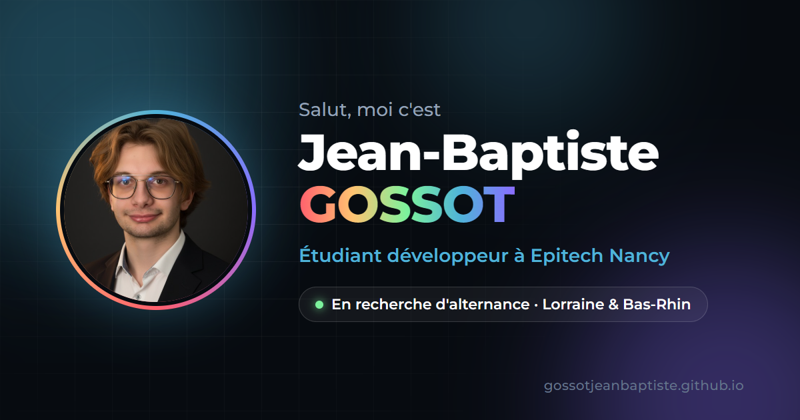

<p align="center">
  
</p>

<h1 align="center">Portfolio</h1>

<p align="center">
  <b>Mon portfolio de développeur, animé au scroll et 100 % statique.</b><br>
  Parcours, expériences et projets d'un étudiant d'Epitech Nancy<br>
  qui cherche une alternance d'un an en Lorraine ou dans le Bas-Rhin.
</p>

<p align="center">
  <a href="https://gossotjeanbaptiste.github.io/"></a>
  
  
  
  <a href="https://github.com/gossotjeanbaptiste/gossotjeanbaptiste.github.io/actions/workflows/deploy.yml"></a>
</p>

---

## À propos

Ce dépôt contient le code de **[gossotjeanbaptiste.github.io](https://gossotjeanbaptiste.github.io/)**, le site qui me sert de CV interactif. On y trouve mon parcours, mes expériences, les projets que j'ai codés (à Epitech et en perso) et de quoi me contacter, en français comme en anglais.

Le site est entièrement statique : pas de backend, pas de base de données. Vite le compile, et GitHub Actions le publie sur GitHub Pages à chaque mise à jour de `main`.

## Points forts

- **Des animations au scroll** : le nom apparaît lettre par lettre, le texte « À propos » s'allume mot par mot, la timeline du parcours se dessine en allumant ses étapes, et les expériences défilent à l'horizontale sur desktop.
- **Des cartes projets en 3D** : elles s'inclinent en suivant la souris, ou le **gyroscope** du téléphone, avec un reflet et une bordure lumineuse.
- **Des petits détails** : smooth scroll, curseur personnalisé, boutons « magnétiques », grille révélée par un spotlight, barre de progression et nav qui se cache au scroll.
- **Bilingue** : un clic sur le drapeau bascule tout le site entre le français et l'anglais, sans recharger la page, et la langue est mémorisée.
- **Accessible** : les animations sont coupées pour les personnes qui ont activé « réduire les animations », et l'ARIA, les contrastes et les dimensions d'images ont été vérifiés.
- **Rapide** : images en WebP sans perte, police en WOFF2 (54 Ko au lieu de 673 Ko), environ 60 Ko de JavaScript compressé. Lighthouse donne **100** en performance sur desktop et **98** sur mobile.
- **Prêt à être partagé** : balises Open Graph et image d'aperçu pour LinkedIn, Discord ou X.

## Installation

Il faut [Node.js](https://nodejs.org/) 20 ou plus.

```sh
git clone https://github.com/gossotjeanbaptiste/gossotjeanbaptiste.github.io.git
cd gossotjeanbaptiste.github.io
npm install
npm run dev
```

Le site est alors disponible sur `http://localhost:5173`.

## Pour les développeurs

| Commande | Rôle |
|----------|------|
| `npm run dev` | serveur de développement, rechargé à chaque modification |
| `npm run build` | build de production dans `dist/` |
| `npm run preview` | sert `dist/`, pour tester la version qui sera en ligne |

**Où modifier quoi :**

- **Les textes** sont dans `public/i18n/fr.json` et `public/i18n/en.json`. Dans `index.html`, chaque élément traduit porte un attribut `data-i18n="clé"`.
- **Les projets** sont dans le tableau `PROJECTS`, en haut de `src/main.js` (image, date, dépôt, badge, technos). Leurs images vont dans `public/images/projects/`.
- **Les animations** sont dans `buildScrollAnimations()` (`src/main.js`), et les effets visuels dans `src/style.css`.
- **Les images** sont rangées par type dans `public/images/` (`projects/`, `companies/`, `icons/`, `flags/`, `schools/`, `profile/`). Une image placée dans `public/images/x.webp` s'appelle avec `/images/x.webp`.

**Déploiement :** on travaille sur la branche `dev`, puis on ouvre une pull request vers `main`. Au merge, le workflow [`deploy.yml`](.github/workflows/deploy.yml) lance `npm run build` et publie `dist/` sur GitHub Pages. Aucun fichier buildé n'est commité. Dans les réglages du dépôt, *Settings → Pages → Source* doit être sur **GitHub Actions**.

## Contact

Pour une question, un retour ou une proposition d'alternance, contactez **Jean-Baptiste GOSSOT** :

- E-mail : [gossotjeanbaptiste@gmail.com](mailto:gossotjeanbaptiste@gmail.com) ou [jean-baptiste.gossot@epitech.eu](mailto:jean-baptiste.gossot@epitech.eu)
- LinkedIn : [Jean-Baptiste GOSSOT](https://www.linkedin.com/in/jbgossot/)
- Portfolio : [gossotjeanbaptiste.github.io](https://gossotjeanbaptiste.github.io)

## Crédits & Licences

- Le site s'appuie sur [**Vite**](https://vite.dev/), [**Tailwind CSS**](https://tailwindcss.com/) et [**Lenis**](https://lenis.darkroom.engineering/), sous licence MIT, et sur [**GSAP**](https://gsap.com/), sous sa [licence standard gratuite](https://gsap.com/standard-license).
- La police **Montserrat** est distribuée sous licence [SIL Open Font License 1.1](https://openfontlicense.org/).
- Les logos d'**Epitech**, de l'**Auto-École Rout'Art** et de **Giphar** appartiennent à leurs propriétaires respectifs et ne servent qu'à illustrer mon parcours.
